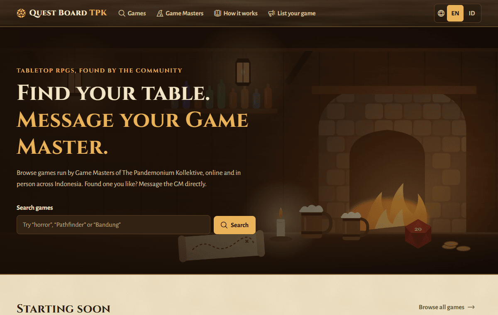
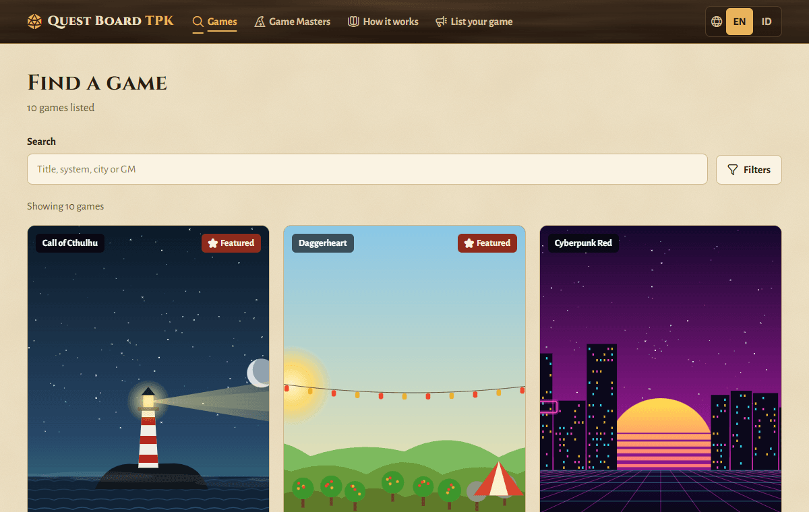
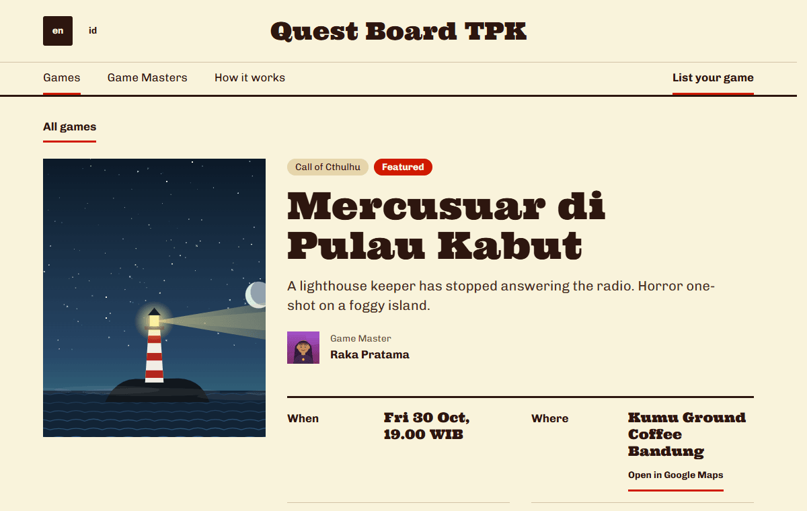
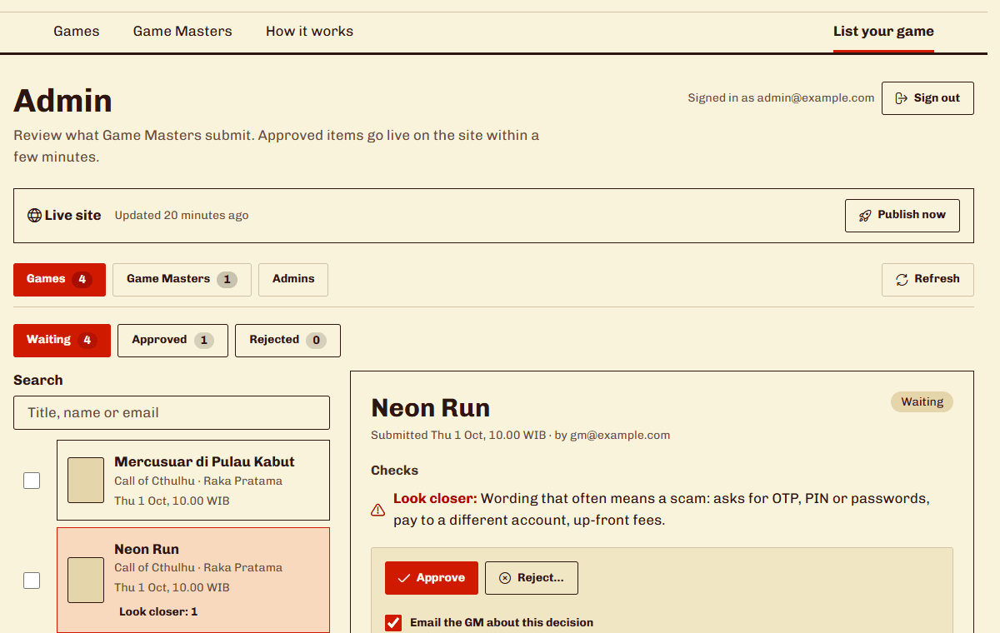
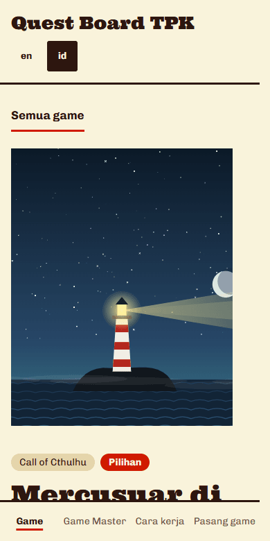

<div align="center">

# ⚔ Quest Board TPK

**Find your table. Message your Game Master.**

A free noticeboard for tabletop RPG games in Jabodetabek and online, run by **The Pandemonium Kollektive** (TPK), in English and Bahasa Indonesia.
Game Masters sign in with their email and list their games, admins review them on a page of the site, and players
message the GM directly on WhatsApp or Discord.

[](https://github.com/addin12/quest-board-tpk/actions/workflows/ci.yml)


</div>

> This is the community edition: **no bookings, no payments.** An account is only a verified email, so a Game Master can edit their own
> listings. The earlier version with seat booking is [Quest Board v1](https://github.com/addin12/Quest-Board) (tag `v1.0-booking`).

## How it works

```
GM signs in with an emailed link and fills in a game  →  an admin approves it on /en/admin/
        →  the site rebuilds (1–3 minutes)  →  players browse, filter and tap “Message on WhatsApp”
```

- **For players:** browse and filter games (system, genre, online or in person, city, language, level, free), open a game,
  and tap the WhatsApp button: the chat opens with a message ready to send. Some GMs also share a Discord.
- **For Game Masters:** one profile, then as many games as they run; an email when an admin decides; they can edit, mark a game full, remove it, or erase their account themselves.
- **For admins:** a review page with a queue, a preview of the card, automatic checks (scam wording, missing date or
  number…), one-click approve or reject with reasons, undo, bulk approve and keyboard shortcuts. Adding another admin is one email address.
- **Cost:** nothing. Cloudflare (Pages, D1, R2, a timer Worker, Turnstile) and GitHub on free plans; email is sent through a small Google Apps Script from the owner's Gmail.

More: [architecture](docs/architecture.md) · [the backend](docs/backend.md) · [going live](docs/cutover.md) · [runbook](docs/runbook.md) · [for admins](docs/curation.md) · [decisions](DECISIONS.md)

## What it looks like

Made-up data, from a local build.

| | |
|---|---|
|  |  |
|  |  |



## Quick start (demo data, no accounts needed)

You need **Node.js 22.13 or later**.

```bash
npm install
npm run dev          # http://localhost:3000/en/  (10 demo games, 4 demo GMs)
```

```bash
npm run build        # the static site, in out/
npm run preview      # http://localhost:4173, served like Cloudflare Pages
```

## Commands

| Command | What it does |
|---|---|
| `npm run dev` | Builds the data, then the development server |
| `npm run build` | The data → `next build` (static export to `out/`) → `fix-export` |
| `npm run preview` | Serves `out/` the way Cloudflare Pages does (`/` → `/en/`, a 404 page) |
| `npm run typecheck` · `npm run lint` | TypeScript (also checks that both languages have every string) · ESLint (also refuses words typed straight into JSX) |
| `npm test` | Unit tests (`node:test`): the backend through its HTTP handler on an in-memory SQLite, the site's logic, and the mail relay's `Code.gs` in a sandbox |
| `npm run test:e2e` | Builds with demo data and runs the real backend code on a test server, then Playwright (Chromium, Firefox, WebKit) |
| `npm run cloudflare:setup` · `npm run cron:deploy` · `npm run script:deploy` | Owner only: create the Cloudflare resources, deploy the timer Worker, push the mail relay (see [docs/cutover.md](docs/cutover.md)) |
| `npm run icons` | Copies the icons listed in `src/lib/icons.ts` out of Phosphor Icons (MIT) into the site |

## Configuration

Everything is read when the site is built. Without any of them the site builds with demo data.

| Variable | Used for |
|---|---|
| `TPK_API_BASE`, `TPK_BUILD_KEY` | The site's own address and the secret build key: where the build gets the real data and pictures from the Cloudflare backend (`/api/public`). Both unset = demo data. Never `NEXT_PUBLIC_`. |
| `NEXT_PUBLIC_SITE_URL` | The site's address (sitemap, canonical links, emails). |
| `NEXT_PUBLIC_TURNSTILE_SITE_KEY` | Cloudflare Turnstile's public site key (the robot check on the sign-in form). Empty = no check. |
| `NEXT_PUBLIC_REPORT_URL` | Optional: where players can report a listing. |

The backend's own settings (database, bucket, secrets) are bindings and encrypted variables of the Pages project, not files: see [docs/backend.md](docs/backend.md) and [docs/cutover.md](docs/cutover.md).

## Project layout

```
worker/ functions/   the backend (D1, R2) · cron/   the timers Worker · apps-script/   the mail relay · docs/   guides · scripts/   build and tooling
src/app/[lang]/   the pages (en, id) · src/components/   UI, admin/ is the review page · src/lib/   logic and strings
tests/   unit, e2e, and support (an in-memory database and bucket) · data/sample.json   demo data
```

## Contributing

Start with [CONTRIBUTING.md](CONTRIBUTING.md) and [CLAUDE.md](CLAUDE.md). A security problem: [SECURITY.md](SECURITY.md). A change is done when `npm run typecheck`, `npm run lint`, `npm test` and
`npm run build` pass, new interface text exists in English and Indonesian, and both themes and a phone width look right.

---

<sub>Icons: [Phosphor Icons](https://phosphoricons.com) (MIT, see [THIRD_PARTY_NOTICES.md](THIRD_PARTY_NOTICES.md)). Illustrations are original and drawn in code. Quest Board TPK is a community project and takes no payments: players and Game Masters arrange everything between themselves. Code under the [MIT License](LICENSE).</sub>
