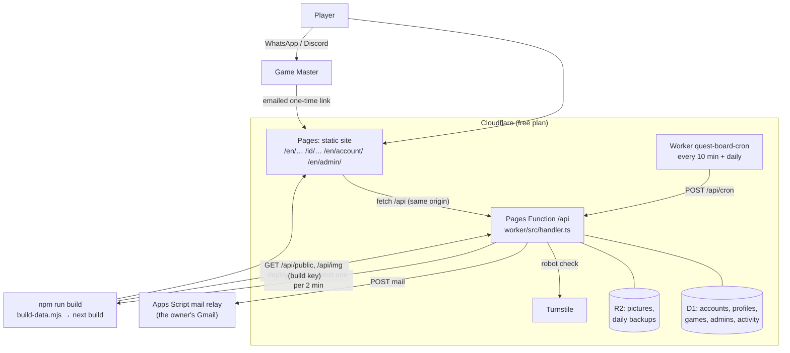
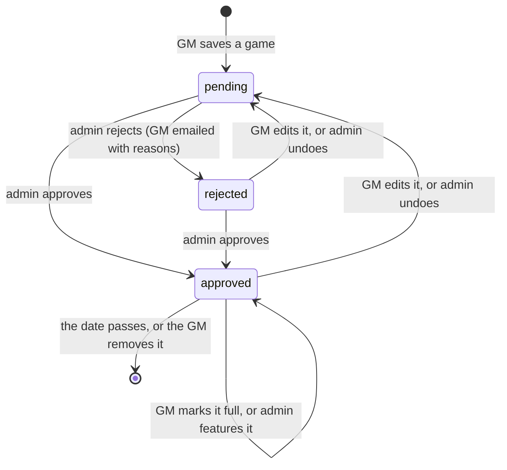

# Architecture

Quest Board TPK is a **static website** with a small **Cloudflare backend** (D1 database, R2 bucket) behind one `/api`. A Game Master
signs in with an emailed link, lists games, and an admin approves them; each approval rebuilds the site. The reasons behind the choices
are in [DECISIONS.md](../DECISIONS.md) (ADR-25 to ADR-27); the API and data are in [backend.md](backend.md).

## The parts



| Part | Where | Job |
|---|---|---|
| Site | `src/` (Next.js static export) | Public pages in English and Indonesian, the sign-in and account pages, and the admin page. |
| Backend | `worker/`, `functions/api/[[path]].ts` | Accounts, profiles, games, review, pictures, builds, backups. One handler with everything injected. |
| Build | `scripts/build-data.mjs`, `fix-export.mjs` | Fetches and **re-validates** the public JSON, downloads and crops pictures, writes `src/generated/data.json`. |
| Timers | `cron/worker.ts` | A tick every 10 minutes (sends a waiting build); a daily job (backup, tidy, rebuild so ended listings leave). |
| Mail relay | `apps-script/Code.gs` | Sends the backend's emails from the owner's Gmail (no domain of our own). At most 90 a day. |

## A listing's life



Only `approved` games of an `approved` GM, not expired, appear in `/api/public`, and only for a request carrying the secret build key.
Marking a game full or removing it needs no review; every other change goes back to `pending`.

## An approval, step by step

```mermaid
sequenceDiagram
  participant Ad as Admin page
  participant F as /api (Pages Function)
  participant D as D1
  participant C as Cloudflare Pages
  Ad->>F: POST /api/admin {action: "review", ids, status: "approved"} (session cookie)
  F->>D: is this session's email the owner or an admin?
  F->>D: set status, reviewer, time; write an activity row
  F-->>Ad: {ok, publishing: true}
  F->>F: mark "something public changed"
  Note over F: at most one build per 2 minutes (the tick sends a waiting one)
  F->>C: POST the deploy hook
  C->>F: GET /api/public?key=… and /api/img/…
  C->>C: build and publish the site
```

## Security, in short

- **The public JSON never contains** emails, notes, rejected or pending rows: it copies a fixed list of fields (tested). The build checks
  the data again (`src/lib/public-data.ts`) and drops what is wrong.
- **Sign-in** is a one-time emailed link (15 minutes); only hashes of links and sessions are stored; the session cookie is `HttpOnly`,
  `SameSite=Lax`. Every write checks the site's own `Origin`. Sign-in and uploads are rate-limited and sit behind Turnstile.
- **Admin power** comes only from the session's email being the owner or on the `admins` table: nothing the page sends can grant it.
- **One rules module** (`src/lib/` imported by `worker/src/rules.ts`) validates a game for both the form and the server, so they cannot drift.
- **Pictures** are identified by their bytes (WebP, JPEG, PNG), size-limited, and only approved ones are served publicly.
- **WhatsApp numbers** are public by the GM's consent; they are not written plainly into the HTML (only a scraper-slowing encoding),
  but anyone who taps the button sees them.
- **Content** is plain text: React escapes it, there is no HTML or link markup from GMs. Map links must be Google Maps, Discord links
  must be Discord, anything else is dropped.
- Headers (`public/_headers`) set a Content Security Policy that allows scripts only from the site and Turnstile.

## Where things are

```
worker/             the backend: handler, rules, store, auth, images, backup, email; migrations/ is the schema
functions/          the one Pages Function that wires D1 and R2 to the handler
cron/               the timers Worker
apps-script/        the mail relay (Code.gs) and its manifest
docs/               this file, backend, cutover, runbook, curation guide, handoff, the audit
scripts/            build-data, fix-export, preview, icons, e2e-build, cloudflare-setup, cron-deploy, push-apps-script, audit-frontend
src/app/[lang]/     the pages: home, games, games/[slug], gms, gm/[slug], how-it-works, list-your-game, account, admin
src/components/     UI pieces; account/ is the GM's pages, admin/ is the curation page
src/lib/            pure logic (types, data check, rules, filters, contact, checks, admin view), i18n/
tests/unit/         node:test: the backend through handle() on in-memory SQLite, site logic, the mail relay
tests/e2e/          Playwright against the real backend code on a test server (tests/support/)
data/sample.json    demo data, used when TPK_API_BASE is not set
```
