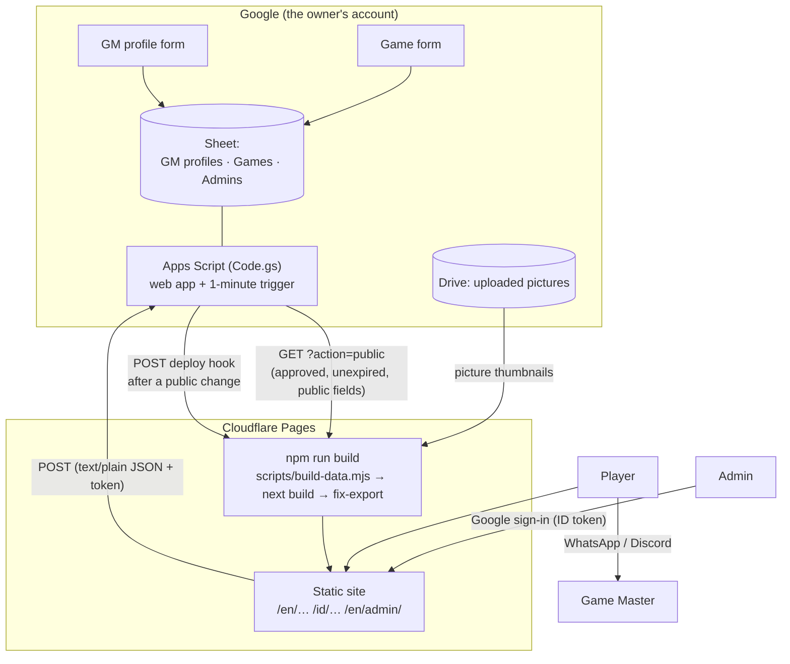
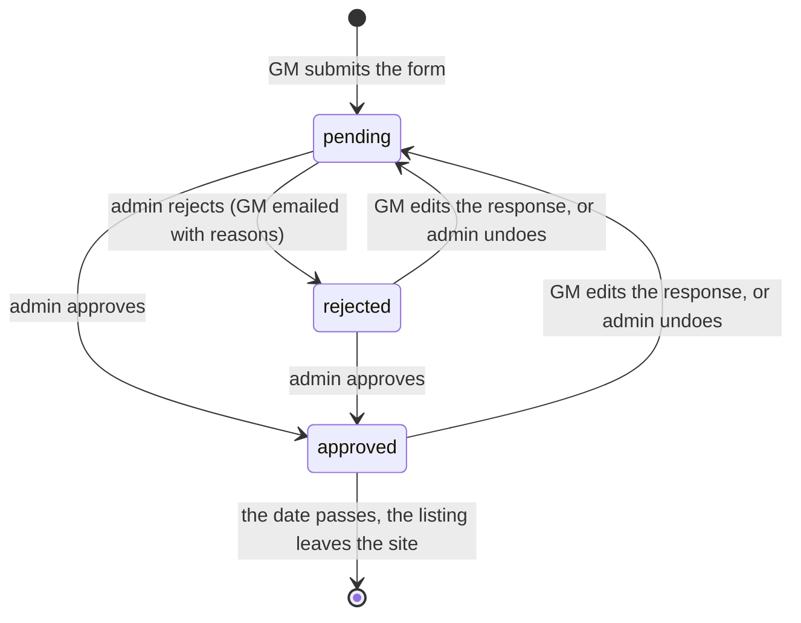

# Architecture

Quest Board TPK is a **static website** whose data lives in a **Google Sheet**. There is no server and no database to run.

## The parts



| Part | Where | Job |
|---|---|---|
| Forms | Google Forms | The only way a GM enters data: sign-in, validation, file upload, edit link. |
| Sheet | Google Sheets | The record: every response, its status, who decided and when. |
| Script | `apps-script/Code.gs` | Gives responses ids, keeps statuses, serves the public JSON, answers the admin API, emails GMs and admins, asks Cloudflare to rebuild. |
| Build | `scripts/build-data.mjs`, `fix-export.mjs` | Fetches and **re-validates** the public JSON, downloads and crops pictures, writes `src/generated/data.json`. |
| Site | `src/` (Next.js static export) | Public pages in English and Indonesian, and the admin page. |

## A listing's life



Only `approved` listings (of an `approved` GM profile, not expired) leave the Sheet through `?action=public`, and only for a request carrying the secret build key (`BUILD_KEY`): the web
app's address is public (the admin page needs it), and this data holds the GMs' WhatsApp numbers.

## An approval, step by step

```mermaid
sequenceDiagram
  participant Ad as Admin page
  participant S as Apps Script
  participant G as Google
  participant C as Cloudflare Pages
  Ad->>S: POST {action: "review", token, ids, status: "approved"}
  S->>G: verify the ID token (oauth2.googleapis.com/tokeninfo)
  S->>S: is the email the owner, or on the Admins tab?
  S->>S: set Status, ReviewedBy, ReviewedAt; share the picture by link
  S-->>Ad: {ok, publishing: true}
  S->>S: remember "something public changed"
  Note over S: tick (every minute): changed ≥ 1 min ago, last build ≥ 5 min ago, fewer than 20 today
  S->>C: POST the deploy hook
  C->>S: GET ?action=public
  C->>C: build and publish the site
```

## Security, in short

- **The public JSON never contains** emails, notes, rejected or pending rows: `buildPublic_` copies a fixed list of fields
  (tested). The build checks the data again (`src/lib/public-data.ts`) and drops what is wrong.
- **The admin API** needs a Google ID token on every call. The script asks Google to verify it (signature, expiry, that it was
  issued to *this* site's client id, that the email is verified) and then looks the email up. The page can't be tricked into
  admin powers by anything it holds: all checks are on the script's side.
- **Visitors never load anything from Google** except the admin: pictures are downloaded at build time.
- **WhatsApp numbers** are public by the GM's consent; they are not written plainly into the HTML (only a scraper-slowing encoding),
  but anyone who taps the button sees them.
- **Content** is plain text: React escapes it, there is no HTML or link markup from GMs. Map links must be Google Maps, Discord
  links must be Discord, anything else is dropped.
- Headers (`public/_headers`) set a Content Security Policy that allows scripts only from the site and Google's sign-in.

## Where things are

```
apps-script/        the Sheet's script (Code.gs) and its manifest
docs/               setup, forms, curation guide, this file
scripts/            build-data (the data), fix-export, preview, form-options, icons, e2e-build
src/app/[lang]/     the pages: home, games, games/[slug], gms, gm/[slug], how-it-works, list-your-game, admin
src/components/     UI pieces; admin/ is the curation page
src/lib/            pure logic (types, data check, filters, contact, checks, admin view), i18n/
tests/unit/         node:test, including Code.gs run in a sandbox
tests/e2e/          Playwright, with Google and the Sheet replaced by tests/support/
data/sample.json    demo data, used when TPK_API_URL is not set
```
