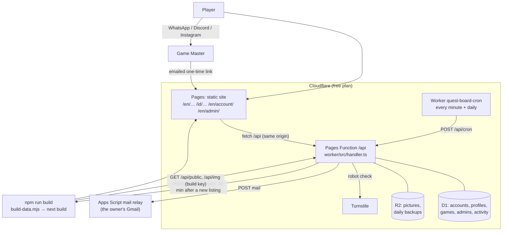
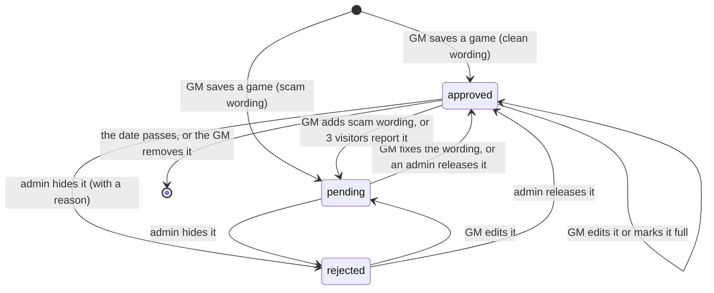

# Architecture

Quest Board TPK is a **static website** with a small **Cloudflare backend** (D1 database, R2 bucket) behind one `/api`. A Game Master
signs in with an emailed link and lists games, which are live at once; the pages read the live data from the backend between builds, and
a build only refreshes the static copy. The reasons behind the choices are in [DECISIONS.md](../DECISIONS.md) (ADR-25 to ADR-27, ADR-48); the API and data are in [backend.md](backend.md).

## The parts



| Part | Where | Job |
|---|---|---|
| Site | `src/` (Next.js static export) | Public pages in English and Indonesian, the sign-in and account pages, and the admin page. |
| Backend | `worker/`, `functions/api/[[path]].ts` | Accounts, profiles, games, review, pictures, builds, backups. One handler with everything injected. |
| Build | `scripts/build-data.mjs`, `fix-export.mjs` | Fetches and **re-validates** the public JSON, downloads and crops pictures, writes `src/generated/data.json`. |
| Timers | `cron/worker.ts` | A tick every minute (sends a waiting build); a daily job (backup, tidy, rebuild so ended listings leave). |
| Mail relay | `apps-script/Code.gs` | Sends the backend's emails from the owner's Gmail (no domain of our own). At most 90 a day. |

## A listing's life



Only `approved` games of an `approved` GM, not expired, are public (`/api/live`, and `/api/public` for the build). The words are kept from before publish-first:
`approved` is shown as **Live**, `pending` as **Held** and `rejected` as **Hidden** (ADR-48).

## A listing going live, step by step

```mermaid
sequenceDiagram
  participant G as Game Master
  participant F as /api (Pages Function)
  participant D as D1
  participant V as Visitor's browser
  participant C as Cloudflare Pages
  G->>F: PUT /api/profile or POST /api/games (session cookie)
  F->>D: scam wording? no: status approved, was_live; yes: pending
  F-->>G: {status}
  F->>F: mark "something public changed" (urgent if it just went live)
  V->>F: GET /api/live (cached about 20 seconds at the edge)
  F-->>V: public data, no phone numbers
  Note over V: the list and the pages show it within a minute
  V->>F: POST /api/contact {gm} on a tap on WhatsApp
  F-->>V: that one number (rate-limited); the chat opens
  F->>C: deploy hook, within 10 minutes if urgent, else within 2 hours
  C->>F: GET /api/public and /api/img/… (Authorization: Bearer key)
  C->>C: build the static copy: pages, sitemap, previews
```

## Security, in short

- **The public JSON never contains** emails, notes, phone numbers, hidden or held rows: it copies a fixed list of fields (tested). The build and the browser
  check the data again (`src/lib/public-data.ts`) and drop what is wrong.
- **Sign-in** is a one-time emailed link (15 minutes); only hashes of links and sessions are stored; the session cookie is `HttpOnly`,
  `SameSite=Lax`. Every write checks the site's own `Origin`. Sign-in and uploads are rate-limited and sit behind Turnstile.
- **Admin power** comes only from the session's email being the owner or on the `admins` table: nothing the page sends can grant it.
- **One rules module** (`src/lib/` imported by `worker/src/rules.ts`) validates a game for both the form and the server, so they cannot drift.
- **Pictures** are identified by their bytes (WebP, JPEG, PNG), size-limited, and only the pictures of live listings are served publicly (cached for good: a replaced picture has a new key).
- **WhatsApp numbers** are not in the public data, the HTML or the build: a tap asks `POST /api/contact` for one Game Master's number (rate-limited per address and
  in all), so a scraper has to tap, a few at a time. The GM consents to this when saving the profile.
- **Content** is plain text: React escapes it, there is no HTML or link markup from GMs. Map links must be Google Maps, Discord links must be Discord, an
  Instagram entry must be a username or an instagram.com profile link (stored as the plain username); anything else is dropped.
- Headers (`public/_headers`) set a Content Security Policy that allows scripts only from the site and Turnstile.

## Where things are

```
worker/             the backend: handler, rules, store, auth, images, backup, email; migrations/ is the schema
functions/          the one Pages Function that wires D1 and R2 to the handler
cron/               the timers Worker
apps-script/        the mail relay (Code.gs) and its manifest
docs/               this file, backend, cutover, runbook, curation guide, handoff, the audit
scripts/            build-data, fix-export, preview, icons, e2e-build, cloudflare-setup, cron-deploy, push-apps-script, audit-frontend
src/app/[lang]/     the pages: home, games, games/[slug], gms, gm/[slug], how-it-works, list-your-game, account, admin
src/components/     UI pieces; account/ is the GM's pages, admin/ is the curation page
src/lib/            pure logic (types, data check, rules, filters, contact, checks, admin view), i18n/
tests/unit/         node:test: the backend through handle() on in-memory SQLite, site logic, the mail relay
tests/e2e/          Playwright against the real backend code on a test server (tests/support/)
data/sample.json    demo data, used when TPK_API_BASE is not set
```
