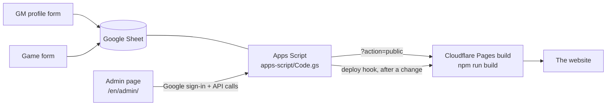

# Setting it up (free, about an hour)

Quest Board TPK costs nothing to run: Google Forms, Sheets and Apps Script for the data and the admin API,
Cloudflare Pages for the website, GitHub for the code. There is no server and no credit card.

You will need: a Google account (the **owner**), a GitHub account, a Cloudflare account.

## 1. The forms and the Sheet

The quick way (about 5 minutes): go to https://script.google.com → New project → paste
[`apps-script/CreateForms.gs`](../apps-script/CreateForms.gs) → Run `createForms` and allow access. It builds both forms
and the Sheet (tabs already named `GM profiles` and `Games`) and writes the links to the Execution log, with the
few by-hand steps Google does not allow from a script (the two file-upload questions and "Verified" email collection).
Then go to step 2.

The by-hand way: create the two forms as described in [forms.md](forms.md), with the options from
[form-options.md](form-options.md), link both to the **same** spreadsheet (Responses → Link to Sheets) and rename the
tabs to exactly `GM profiles` and `Games`.

## 2. The script

1. In the Sheet: Extensions → Apps Script. Replace the contents of `Code.gs` with [`apps-script/Code.gs`](../apps-script/Code.gs).
2. Project Settings → tick *Show "appsscript.json" manifest file in editor*, open `appsscript.json` and replace it with
   [`apps-script/appsscript.json`](../apps-script/appsscript.json).
3. Select `setup` in the toolbar → Run. Google asks you to authorise: *Advanced → Go to … (unsafe)* is normal for your own
   script. When it finishes, open Execution log: it lists anything still missing (a renamed question, a property not set yet).
   It also creates a secret **build key** (script property `BUILD_KEY`) and logs it: the public data, which holds the
   GMs' WhatsApp numbers, is only given to a request that carries this key (step 5 uses it).

## 3. Sign-in for the admin page (a Google "OAuth client", free)

The admin page signs in with Google. Google needs to know the page is yours:

1. https://console.cloud.google.com → create a project (any name, no billing).
2. APIs & Services → OAuth consent screen (Google Auth Platform) → Get started → app name *Quest Board TPK* → your email
   → *External* → create. **Leave the app in "Testing"** and add every admin under Audience → Test users (up to 100).
   Publishing would need your own domain with a privacy policy and terms pages on it: `pages.dev` can't be registered as
   an authorised domain, and the Publish button stays disabled without it. Testing is enough here: the page only signs
   people in. Admins see Google's "hasn't verified this app" screen once and click *Continue*; players never sign in.
3. Clients → Create client → Web application. *Authorised JavaScript origins*: your site's address
   (e.g. `https://quest-board-tpk.pages.dev`) and `http://localhost:4173` for trying it locally. Copy the **Client ID**.

## 4. The web app (the API)

1. In Apps Script: Project Settings → Script properties → add `CLIENT_ID` = the Client ID from step 3, and
   `SITE_URL` = your site's address (no trailing slash). (`DEPLOY_HOOK` comes in step 5.)
2. Deploy → New deployment → type *Web app* → Execute as **Me** → Who has access **Anyone** → Deploy.
   Copy the **Web app URL** (it ends in `/exec`).
   After changing `Code.gs` later: Deploy → Manage deployments → Edit → *New version*.

## 5. The website

1. Push this repository to GitHub (public is fine: it contains no data and no secrets).
2. Cloudflare dashboard → Workers & Pages → Create → Pages → Connect to Git → pick the repository.
   Build command `npm run build`, build output directory `out`, environment variable `NODE_VERSION` = `24`.
3. Add these environment variables (Settings → Environment variables, Production):

   | Variable | Value |
   |---|---|
   | `TPK_API_URL` | the Web app URL followed by `?key=` and the build key from step 2: `…/exec?key=…` (keep it a plain Text variable, never `NEXT_PUBLIC_`) |
   | `NEXT_PUBLIC_ADMIN_API_URL` | the same Web app URL |
   | `NEXT_PUBLIC_GOOGLE_CLIENT_ID` | the Client ID |
   | `NEXT_PUBLIC_SITE_URL` | your site's address |
   | `NEXT_PUBLIC_GM_FORM_URL` | the GM profile form's public link |
   | `NEXT_PUBLIC_GAME_FORM_URL` | the game form's public link |
   | `NEXT_PUBLIC_REPORT_URL` | optional: a link where players can report a listing |

4. Settings → Builds → Deploy hooks → create one → copy its URL into the script property `DEPLOY_HOOK`.
5. Re-deploy once so the first build uses these values.

## 6. Check it

1. Fill both forms as a test GM. Within a minute the rows get an `Id` and `Status = pending`.
2. Open `/en/admin/`, sign in with the owner's Google account, approve the profile and the game.
3. After a minute or two the game is on the site. (*Publish now* on the admin page starts the rebuild at once.)

## Adding another admin

Two steps, because the Google app is in Testing (step 3): add their Google (Gmail) address in Google Cloud under
Audience → Test users, **and** on the admin page → **Admins** → *Add admin*. They sign in at the same page. Removing
someone is one click on the admin page (also remove them from Test users). The owner (the Google account that owns the
script) is always an admin.

## What it costs, and the limits

| Part | Free limit | What it means here |
|---|---|---|
| Google Forms / Sheets | no limit that matters | hundreds of listings are fine |
| Apps Script | 90 min of triggers a day; 20,000 outgoing requests; 100 emails a day | the script runs for under a second a minute; decision emails stay far below 100 |
| Cloudflare Pages | 500 builds a month | the script rebuilds at most once per 5 minutes and 20 times a day, and once at night |
| GitHub | public repos are free | |
| Drive | 15 GB (your account) | covers are well under 10 MB each |

If a build ever fails (the script is unreachable, the data is nonsense) the site that is live stays as it is.
